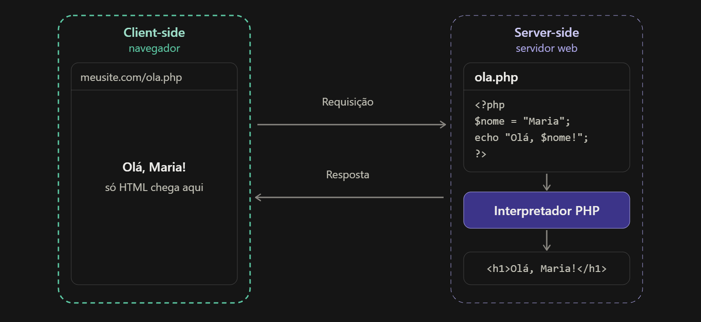

📰 o banco MySQL está presente em sitejogos.sql

  
  

----

A Perdendo é uma loja fictícia de jogos virtuais, fiz ela estudando através do curso do gustavo guanabara de PHP,
no curso aprendi muitos conceitos importantes como

funcionamento de https,
como um servidor responde a uma chamada de cliente,
respostas 404,403... e metodos get, put...
Integração e organização de informações utilizando banco de dados MySQL.
Recebimento e tratamento de dados enviados através de formulários.
Manipulação de variáveis, constantes, tipos de dados e strings.
Implementação de CRUD, operações de criação, leitura, atualização e exclusão de registros em um banco de dados.
Segurança contra SQL Injection, compreensão de vulnerabilidades que permitem a usuários mal-intencionados inserir comandos SQL indevidos através de campos de entrada.
Sessions, mecanismo utilizado para armazenar informações temporárias de um usuário entre diferentes requisições, como manter seu estado de autenticação durante a navegação.
Prepared Statements, utilização de consultas SQL parametrizadas, separando os comandos SQL dos dados recebidos, ajudando a prevenir ataques de SQL Injection.

---

#PHP

O PHP é uma linguagem server-side, ou seja ela funciona do lado do servidor e _echoa_ apenas o html para o cliente quando ele acessa.

O navegador não recebe o código PHP em si, mas sim a resposta que o servidor produziu. Geralmente essa resposta é HTML, mas também pode ser JSON, texto e outros formatos.

O PHP pode ser misturado com HTML dentro de um mesmo arquivo, permitindo criar páginas dinâmicas, onde o conteúdo muda de acordo com informações recebidas pelo servidor.

---

